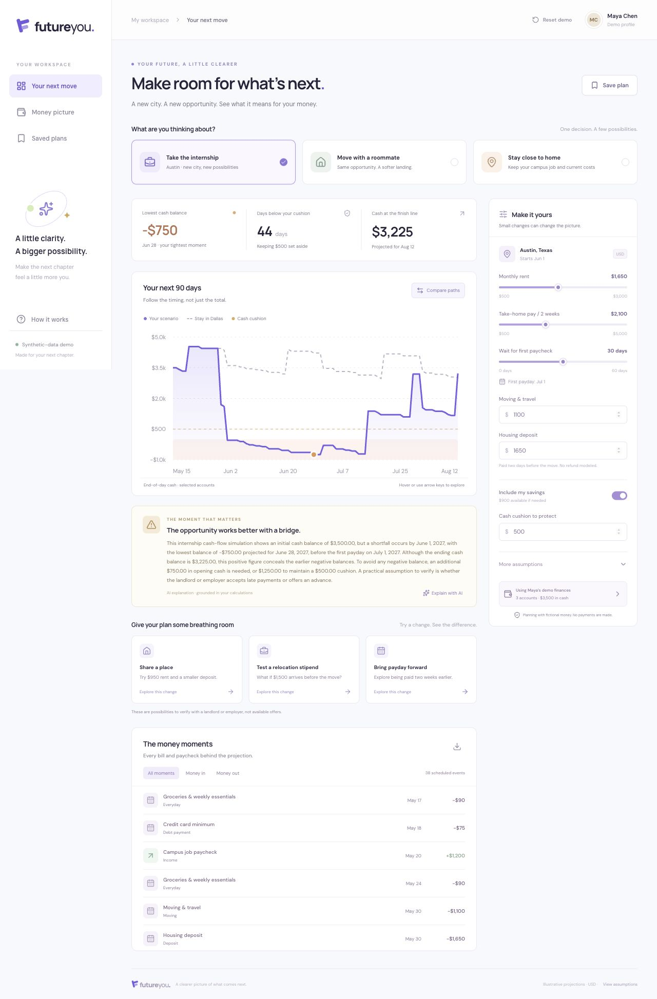

# FutureYou

**[Open the live demo](https://futureyou-utd-26.vercel.app)**

See whether a major life decision fits your finances, including the awkward gap before the first paycheck.



This branch implements a complete interactive internship-planning demo with synthetic student finances. Next.js and React render the app; a deterministic TypeScript engine computes daily balances; Capital One Nessie supplies real sandbox balances and recurring bills. MongoDB Atlas saving and Gemini explanations activate when their server credentials are configured.

## Run locally

Use Node.js 24 and npm. From this directory:

```sh
npm ci
cp .env.example .env.local
npm run dev
```

Open http://127.0.0.1:3000. The built-in fictional profile works immediately without keys. Do not overwrite an existing `.env.local`.

## Connect Nessie

1. Create a sandbox API key at [Nessie](https://prod.nessieisreal.com/).
2. Set `NESSIE_API_KEY` in the ignored `.env.local` file.
3. Run `node scripts/seed-nessie.mjs`. This creates a fictional Maya Chen profile, three named accounts, and five monthly bills, then records `NESSIE_CUSTOMER_ID` locally. Rerunning reuses matching records; it does not reset balances or make payments.
4. Restart the dev server if necessary, open **Money picture → Connect Nessie → Import sandbox accounts**.

The app reads only the configured sandbox customer. It never offers access to arbitrary customers and never transfers funds. API credentials remain server-side. The official API base is `https://prod-api.nessieisreal.com`.

## What works

- A 90-day timeline for a summer internship, moving with a roommate, or staying in Dallas.
- Adjustable rent, net pay, first-paycheck delay, moving costs, deposits, savings, cash cushion, stipend, purchases, and weekly expenses.
- Lowest cash balance, days below the cushion, ending cash, comparison chart, dated ledger, and CSV export.
- Scenario snapshots with browser persistence; optional MongoDB Atlas storage scoped to an anonymous browser session.
- Nessie balances and monthly bills imported into the actual calculation inputs.
- Optional Gemini explanation grounded in server-recomputed numbers; deterministic summaries remain available without AI.
- Responsive layouts, keyboard-accessible inputs, explicit data-source status, and a calculation-method page.

The default fictional internship reaches **−$750 on June 28, 2027** despite ending at **$3,225**. The roommate preset reaches a minimum of **$1,100** and ends at **$6,475**. These are reproducible simulation outputs, not forecasts for a real person.

## Services and deployment

| Variable | Purpose |
| --- | --- |
| `NESSIE_API_KEY` | Server-side sandbox authorization |
| `NESSIE_CUSTOMER_ID` | Fictional customer selected by the seed script |
| `MONGODB_URI` | Optional native-driver connection string |
| `MONGODB_DB` | Database name; defaults to `futureyou` |
| `GEMINI_API_KEY` | Optional AI explanation API key |
| `GEMINI_MODEL` | Model ID; defaults to `gemini-2.5-flash` |

Hosting: Vercel project `futureyou-utd-26` under `adyaanakrams-projects`. Use server-side production environment variables, then `vercel deploy --prod`. Do not upload `.env.local`. See [architecture](docs/ARCHITECTURE.md), [MongoDB setup](docs/MONGODB.md), and [demo script](docs/DEMO.md).

At initial delivery, Nessie imports and Gemini explanations are connected and verified. The Atlas connector has not created the requested application user because its execution confirmation remains unresolved. Plans therefore use browser storage; the Atlas API implementation is ready for credentials. An existing Atlas cluster alone does not enable cloud saving.

## Validation

```sh
npm run typecheck
npm test
npm run build
```

Tests cover conservation of cash, payroll timing, one-time expenses, savings/debt treatment, calendar boundaries, negative balances, late stipends, Nessie normalization, validation, and CSV safety. GitHub Actions runs the same checks without secrets.

## Scope and credits

This is a hackathon prototype using fictional money. Dates are a fixed May 15–August 12, 2027 example, not today's calendar. No real bank linking, transfers, tax estimation, investment advice, overdraft fees, deposit refunds, or account authentication are implemented. Clearing browser storage or losing the anonymous session loses access to that browser's plans.

Built with Next.js, React, TypeScript, MongoDB Node driver, Zod, Lucide icons, and DM Sans/Manrope fonts from Google Fonts. The existing organization starter and team workflow files predate this app. No open-source license has been selected.

Development branch: `feat/futureyou`. Other project branches remain independent until the team chooses what to merge.
