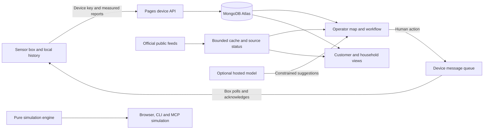

# Safe Home architecture

Current as of November 8, 2026. This is the current system map; previous implementation history remains in [WORKLOG.md](WORKLOG.md). [Brand compatibility](BRAND.md) explains retained HomeBeacon identifiers.

## End-to-end flow

Synthetic frames are isolated from live telemetry. A diagram edge describes software integration, not proof that a physical device or third-party provider is operating.

## Browser and product surfaces

Static HTML in `public/` loads esbuild bundles from `ui/`. The stack is vanilla JS/CSS, not React or Next.js. `ui/marketing.js` renders the public site; `ui/app.js` boots authentication, account/legal routes and the command workspace; `ui/customer.js` owns the household experience. `ui/command/` contains map controls, detail pages, live state and source layers.

The actual Argus kit is vendored under `ui/kit/vendor/`. Product tokens and glue live outside the vendor directory. MapLibre renders OpenFreeMap streets, state boundaries, device points and bounded source overlays. Sources carry status, timestamps, coverage limits and attribution. See [UI kit](UI_KIT.md), [world views](MAP_WORLD_VIEWS.md) and [world feeds](WORLD_FEEDS.md).

The Workflow tab uses DOM checkpoint cards and SVG connectors. Its left history rail, top replay controls and below-node explanations share the existing timeline contract. It never calls a model to invent explanations. [Workflow canvas](WORKFLOW_CANVAS.md) covers playback, refresh and accessibility behavior.

## API and storage boundaries

Cloudflare Pages Functions route requests into the server modules. Dhruv's `src/app.js` exposes device enrollment, keys, legacy readings, rules, alerts, events and the document-store API. `src/beacon.js` adds home/device association, time-series telemetry, retry receipts, latched incidents, audit and geospatial queries. These are existing interoperating contracts, not interchangeable adapters. Read [API.md](API.md) and [mongodb-architecture.md](mongodb-architecture.md) before ingest changes.

The shared application database remains `utd_hackathon_26`. Connection helpers in `src/db.js` and `lib/mongodb.js` respect request-bound Cloudflare networking. Customer pairing and household sharing use ordinary-collection MongoDB transactions and require Atlas or a replica set. Time-series ingestion has separate retry/reconciliation semantics; ambiguous writes must use its documented paused-ingestion procedure.

Risk modules under `src/risk/` combine supported readings, duration thresholds and recorded context for review. Operator snapshots poll about every four seconds; customers about every ten seconds. These are targets, not delivery guarantees. Missing observations remain unknown and stale critical evidence is retained. [Risk](risk.md), [downlink](LIVE_DOWNLINK.md) and [data operations](DATA_OPERATIONS.md) define the contracts.

## Identities and authority

Operator sessions, customer sessions, per-device keys, customer OAuth tokens and infrastructure credentials serve different purposes. Customer signup is implemented; public operator enrollment and general enterprise tenancy are not. Same-origin checks protect browser mutations. Password/account changes invalidate appropriate sessions or sharing bindings.

Customers claim a serial/code at an entered address, or register a self-built device after password confirmation. Household membership grants selected-device read access with revocation and account-generation checks. It does not grant operator actions or infrastructure access. See [customer](CUSTOMER.md), [households](HOUSEHOLDS.md) and [assistant connections](ASSISTANT_CONNECTIONS.md).

## History, messages and assistants

Device reports, logs, retained local history and daily summaries have distinct retention and identity rules. Box-side reference learning continues offline; website history uses synchronized records. Learned references do not silently replace alarm limits. Firmware support exists, but board calibration, flash state, power endurance and replay must be verified physically. [Device history](DEVICE_HISTORY.md) is authoritative.

Operators explicitly queue messages; boxes poll and acknowledge them. Queued, delivered, acknowledged, expired and cancelled are separate states. A help status is a human-entered record, not dispatch confirmation. Household email code and templates are prepared, but sending remains disabled.

The bounded operator investigation uses `src/system-agent.js`, `src/system-evidence.js` and `src/nemotron.js`. Customer assistants use separate OAuth MCP scope or an encrypted account-owned NVIDIA key. Models cannot execute arbitrary database queries or mutate hazard observations. A prior successful integration test does not establish current model uptime.

## Simulation and delivery

`domain/simulation.js` is the shared deterministic engine for five-page browser setup, `/api/simulations`, CLI and MCP tools. The browser keeps configuration, seed, epoch and playback position; simulation imports regenerate frames rather than trusting supplied property records. [Simulations](SIMULATIONS.md) documents bounds and interfaces.

GitHub Actions tests against MongoDB, builds with Node 22 and deploys same-repository previews or production `main`. A successful upload is followed by runtime readiness and browser/asset checks. See [Development](DEVELOPMENT.md) and [Operations](OPERATIONS_RUNBOOK.md). Automated checks do not substitute for full manual accessibility review or hardware testing.
