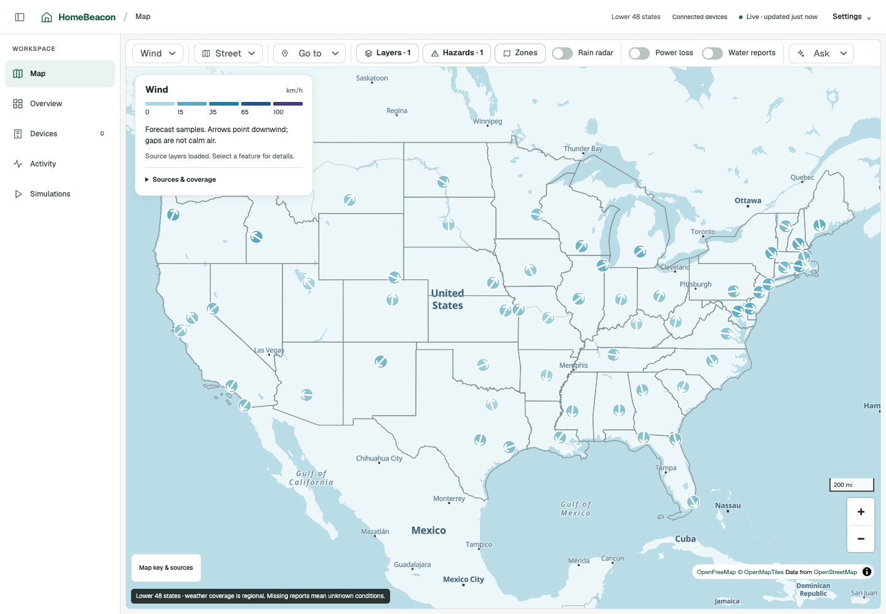
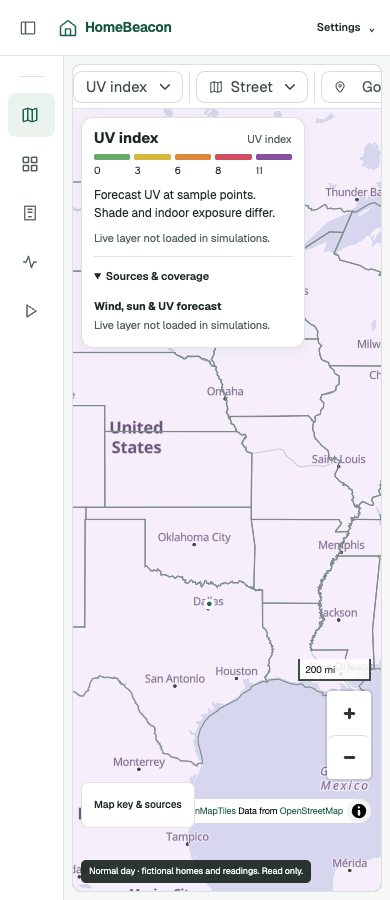

# Map world views

## Brief and visual direction

Each subject changes the map itself, not the surrounding application. Keep Argus menus, Geist text, lower-48 navigation, white streets and recognizable device status colors. Use an in-map View dropdown and a compact, left-aligned legend below the toolbar. Quiet surrounding controls let geography carry the visual emphasis.

Palettes: wind blue `#2068a8` / water `#124c86` / white labels; sunlight pale gold `#fff8df` / amber `#b67400`; UV lavender `#f6effb` / violet `#873aa8`; water pale blue `#eef6fc` / blue `#2465ad`; earth chalk `#f1eee7` / umber `#86593c`; fire porcelain `#fff2eb` / orange `#d84b19`. Air quality uses the AQI scale. Power keeps neutral streets and highlights reported power loss. These are cartographic colors, never replacements for device alert colors.

Do not create a continuous measurement surface from sparse points. Weather values use sampled forecast markers and wind direction arrows. Terrain uses USGS relief; flood zones are mapped FEMA hazard areas, not current flood extent. Fault traces are historic geology, not predictions. All unavailable/stale/partial data must remain visible as such. Simulations never quietly fetch real protected data.

## Implementation plan

1. Add bounded, cached atmosphere and fault feeds with official source verification, source timestamps, missing-value handling and tests. Own new feed module/tests and feed-layers registration only.
2. Add a view catalog, thematic map rendering, Argus view selection and concise legends for existing and new sources. Preserve overlay preferences on leaving a view, device layers, base switching and mobile behavior. Own command UI and UI tests.
3. Independently review the combined change; build, test, inspect actual browser renders, merge and verify production. Record evidence and limitations here and in the worklog.

## Interface

New `atmosphere` feed: Point features with `wind_kph`, `wind_direction`, `solar_wm2`, `uv_index`, `temperature_c`, `validAt`, and source provenance. `observedAt` is null because these are forecasts. Fields may be null; missing is never zero. New `faults` feed: LineString/MultiLineString with name, source, age where supplied. Both use the existing feed cache and response envelope. See [WORLD_FEEDS.md](WORLD_FEEDS.md) for exact sampling/coverage limits.

## Review of direction

The subject palette belongs to the geography; no generic page recoloring or decorative gradients. Legend scales represent actual values. Live wind flow is bounded to short trails near each forecast sample. The blue base is a subject palette, not an interpolated measurement surface. Speed labels retain the sample value and units; space between samples has no inferred weather.

## Implemented behavior

The first Argus dropdown inside the map offers Overview, Wind, Sunshine, UV index, Temperature, Terrain, Flood zones, Rivers & coast, Air quality, Fire, Faults & earthquakes, Power, Weather alerts, Declared disasters and Shelters. The adjacent base selector still controls streets/topography. Terrain uses USGS topographic tiles; fault context also enables relief. Each themed view focuses the relevant feed layers, with device statuses kept above them. Returning to Overview restores the original base, overlays and report highlights, including after reload.

Wind arrows and short animated trails point downwind and are suppressed for calm/unknown direction. Labels show km/h from the national view onward. Pause wind stops motion; reduced motion, hidden pages and offscreen maps also stop the animation. The layer cleans up its animation and listeners when the map is removed. The national weather samples cover 60 fixed request locations at all map zooms. They do not create a continuous field or local weather where no sample exists. Fault traces request bounded local areas at zoom 10 or closer; unusually wide viewports may require a closer zoom. FEMA flood mapping retains its existing zoom 11 threshold. Source keys and coverage limits for existing feeds remain unchanged.

The compact legend gives the scale, units and a short interpretation. Sources & coverage expands for retrieved age, forecast valid time, partial/failed/stale status and feed notes. Missing selected-metric values do not count as coverage. Simulations show an explicit live-layer-not-loaded state and never request protected feed APIs; simulation wind remains synthetic. Presets use documented illustration speeds; custom wind simulations use the configured speed only during the event window and place their illustration around the configured affected area. No simulated weather is written into the live feed or device observations. Unknown readings never become zero or green.

## Verification so far

- Independent feed review passed, with 137 targeted tests and fresh upstream checks returning 60 forecast points and 91 Bay Area fault traces.
- Real Chrome rendered captured public-source data using actual MapLibre layers, arrow rotation, labels and topographic/street style reloads without renderer errors. Additional bounded fixtures exercised the full numeric color scales, including nighttime solar zeros.
- Actual simulation-page checks passed dropdown selection, reload/baseline restoration, keyboard focus through refresh, reduced motion, desktop/390px reflow, zero automated legend accessibility violations, and no protected feed requests.
- An operator browser fixture exercised source data, valid time, null UV, permission failure, stale data and focus preservation. It is browser integration coverage, not a claim of production authentication or household telemetry verification.

Final isolated release/production evidence is recorded in the worklog. Manual accessibility and physical device tests are separate from these checks.

### Review captures

These are browser verification captures, not a live service. The wind screen uses captured public-source forecast points with a browser-only operator fixture and no household records. The phone screen is a simulation and explicitly does not load live weather.

November 8 homepage/wind refinement: the public hero also uses the blue wind view, but its caption explicitly identifies a simulation. Speed plates draw above trails, and nearby trails are thinned to avoid overlap. Other map views retain their palettes and the Overview restores its prior base/overlays. Tests: `test/wind-flow.test.js` and `test/marketing-weather.browser.mjs`; production evidence belongs in WORKLOG.
