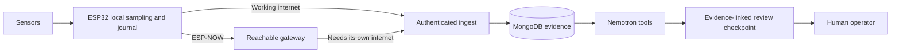

# HomeBeacon system intelligence

November 7, 2026. Adyaan's integration workstream, preserving Ayan's command-center/product work and Dhruv's firmware/API work.

## Implemented in this branch

- Evidence joins: home → device → sensor reading/event → unresolved incident. MongoDB stays; these are document relationships, not a SQL migration.
- Source timestamps and receipt timestamps stay separate. An old reading uploaded after reconnection is not presented as a fresh observation. Missing/stale evidence is unknown; last-known critical observations stay visible.
- Deterministic normal/saver/critical policies and explicit battery projections. Policy proposals cannot disable alarms, logging, the help button or peer reception.
- Bounded NVIDIA function-calling workflow and an explicitly labeled simulator. Each run saves a 30-day evidence snapshot, tool-action trace and internal review checkpoint.
- Operator-only API routes, exercise/live separation, request idempotency, validated tools/source IDs, time/call/rate limits, and no model-directed arbitrary queries or hardware commands.

The existing map UI and firmware sketches are unchanged. Cloud policy fields say `appliedToHardware: false`. The portable `firmware/common/power_policy.h` compiles on the host and matches server timings, but is **not integrated into either sketch**.

## API contract

`GET /api/ops/system?device_id=<id>&mode=exercise` returns the evidence graph, sensor timeline, correlations, policies and NVIDIA configuration state. Omit `mode=exercise` for live records. Scope: target plus up to seven same-home peers. Latest readings per sensor are loaded independently of the bounded history (200 readings, 50 events and 20 active incidents per device); truncation is explicit. Active critical incidents are checked separately so the cap cannot clear them.

`POST /api/ops/agent?mode=exercise` starts an investigation:

```json
{
  "requestId": "demo-investigation-001",
  "deviceId": "REPLACE_WITH_REGISTERED_EXERCISE_DEVICE_ID",
  "engine": "simulator",
  "goalHours": 24,
  "budget": {
    "basis": "assumption",
    "remainingWh": 8,
    "reserveFraction": 0.15,
    "loadsWatts": { "normal": 1, "saver": 0.2, "critical": 0.4 }
  }
}
```

The example energy/draw values are fictional. A budget applies only to the target box, not every peer or the hub. Omit it to show runtime as unknown. `basis: "bench_measurement"` is an operator assertion, not independent certification by the server. `goalHours` defaults to 24 and accepts 1–168.

Use the existing operator session/same-origin flow or server-side admin key. Anonymous callers and public demo accounts cannot use these endpoints. Never put the admin key in browser code. The simulator is allowed only on exercise devices. `engine: "nemotron"` makes actual model calls; missing credentials/upstream errors fail explicitly and never silently switch to simulation.

`GET /api/ops/agent` reports configuration and tool names, not verified connectivity. `GET /api/ops/agent?mode=exercise&run_id=<id>` retrieves the calling operator's run. An identical request ID returns the existing run without repeating inference; changed inputs with the same ID return 409. Failed runs remain failed; submit a new ID deliberately after fixing the cause. A terminated request may leave a running audit record: background resume and scheduled investigation are not implemented.

## Nemotron beyond a chatbot

1. `read_sensor_timeline` inspects source readings, observation/receipt timestamps and open incidents.
2. `correlate_signals` evaluates explicit relationships, such as water and power loss reported by the same device within two minutes. Co-occurrence does not prove causation.
3. `plan_power_budget` runs deterministic policies and energy calculations.
4. `save_review_checkpoint` saves an evidence-cited interpretation and pending internal follow-up action after the investigation tools complete.

Limits: four model rounds, eight tools, 55-second workflow deadline, 20-second individual request deadline, four investigations per operator per minute. Only allowlisted fields reach the model: no names, addresses, credentials or arbitrary notes. Model prose is marked unverified; cited IDs must exist. Checkpoints do not send messages, contact vendors, dispatch responders, decide claims, clear critical incidents or change hardware settings. This creates a reviewable work product rather than just a conversational answer.

**Current user choice: labeled simulator.** This does not demonstrate real Nemotron use for the NVIDIA prize. Later, privately set `NVIDIA_API_KEY` in ignored `.env` and in Cloudflare's server secret store. Run `npm run nvidia:check`, then the full workflow with `engine: "nemotron"` on exercise data. The current default is the team's existing `nvidia/llama-3.3-nemotron-super-49b-v1.5`; override with `NVIDIA_MODEL` if needed. Real model availability/tool quality remain unverified.

Official references: [NVIDIA function calling](https://docs.nvidia.com/nim/large-language-models/1.15.0/function-calling.html), [hosted model endpoint](https://docs.api.nvidia.com/nim/reference/nvidia-llama-3_3-nemotron-super-49b-v1_5-infer).

## Whole-system responsibilities



The box must sample, log, retain alerts and handle its button without cloud inference. Nemotron is a server-side model, not an LLM running on the ESP32. Cloud investigation follows upload; during disconnection the command center has last-known evidence, not live knowledge.

Wi-Fi RSSI, association, internet reachability and API acknowledgement are separate signals. RSSI is not speed. Prefer bounded authenticated upload probes over battery-draining speed tests. ESP-NOW is a local peer link, not an internet service; a reachable gateway still needs its own uplink. See [Espressif ESP-NOW](https://docs.espressif.com/projects/esp-idf/en/stable/esp32s3/api-reference/network/esp_now.html).

## Power targets

| Mode | Trigger | Sample | Report | Wi-Fi retry | Optional loads |
| --- | --- | --- | --- | --- | --- |
| Normal | Fresh mains present, no critical condition | 2 s | 30 s | 60 s | Camera/display allowed |
| Saver | Power lost or unknown | 2 s | 120 s | 300 s | Camera/display off |
| Critical | Current/last-known critical observation or unresolved critical incident | 2 s | 30 s | 60 s | Camera/display off; essentials retained |

These are proposed timings, not measured guarantees. The existing firmware has blocking network calls; guaranteed two-second sampling during uploads requires a nonblocking network task and bench validation. Do not deep-sleep the gateway without a tested peer wake schedule: ordinary [light/deep sleep powers down wireless peripherals](https://docs.espressif.com/projects/esp-idf/en/stable/esp32s3/api-reference/system/sleep_modes.html).

Runtime = `remaining usable Wh × (1 − reserve fraction) / average measured W`. Reserve defaults to 15%. **24 hours is a design target; 72 hours is a stretch goal. Neither is measured.** A missed goal asks for more usable capacity/less optional load, never disabled critical functions. The existing firmware's box-B voltage-to-percent conversion is an uncalibrated legacy estimate. This new engine never treats voltage or that percentage as usable Wh. Box A currently has no measured battery state of charge.

## Confirmed pickup and physical build

The user's November 7 6:53 PM HARP screenshot says **Picked up**. Visible: USB-C cable ×1; **6×AA holder ×1**; breadboard ×1; jumper kit ×1; diodes ×4; F-F/M-F jumper sets ×1 each; resistors ×10; DS1307 ×2; flame ×1; PIR ×1; power module ×2; tilt ×1; water sensor ×2. The title says “+18 more”; unseen items are not independently confirmed. Existing repo records separately list team-owned ESP32-S3 Sense, ESP32, Uno Q, microSD, button and buzzer.

Use one battery-backed water/power recorder as the primary demo and the other board as a peer. One holder does not establish independent backup for two boxes and the hub. It also does not establish installed cells, chemistry, capacity or working switchover. No cellular/LoRa radio or air-quality sensor is visible in the screenshot.

Water ADC counts are not flood depth without calibration. PIR cannot prove a home empty. Flame/sound modules are proxies, not certified fire/smoke detectors.

Before powering the boards, identify the exact power-module model, regulator type, output rails and peak-current rating. No raw AA pack voltage goes to GPIO, the 3.3 V rail or lithium battery pads. Sense the isolated low-voltage wall supply upstream of backup, never household AC. Check divider output over the fresh-pack voltage range and verify USB/backfeed protection. Follow [Seeed's board power documentation](https://wiki.seeedstudio.com/xiao_esp32s3_getting_started/).

The [DS1307 datasheet](https://www.analog.com/media/en/technical-documentation/data-sheets/DS1307.pdf) specifies 5 V operation and battery-backed timekeeping. Inspect module I2C pull-up voltage and any coin-cell charging circuit before connecting to the ESP32 bus. Clock battery backup does not power the box. A proper UPS/power-path controller or level shifter is not confirmed by the screenshot.

## Bench acceptance and remaining firmware work

| Test | Evidence needed | Current status |
| --- | --- | --- |
| Water event | Calibrated wet/dry threshold, original timestamp and stable event ID | Physical test pending |
| Pull wall supply | No reboot; loss event while recording continues | Power-path test pending |
| Remove internet | Continued SD samples, stale cloud state | Physical test pending |
| Reconnect | Original timestamps replay, duplicate handling, unresolved critical retained | Backend tested; physical replay pending |
| Shed optional loads | Measured current reduction with alarms/logging/relay intact | Reference policy only |
| Endurance | Continuous unplugged run plus measured energy/draw | 24 h target only |

Before relying on firmware replay, reconcile its classification of every HTTP 409 as permanent: beacon ingest also uses a transient 409 for processing receipts. Test SD-full behavior, interruption during queue-offset writes, and ACK durability. These are recorded integration gaps, not claimed fixes in this branch.

## Run and present

`npm ci` then `npm run system:demo` starts disposable local MongoDB, creates synthetic water/power/Wi-Fi observations, runs the explicit simulator, persists and retrieves the checkpoint, then shuts down. It never accesses Atlas or production homes. Add `-- --output /tmp/homebeacon-system-demo.json` for a synthetic artifact.

For four speakers in three minutes: problem/year-round leak prevention (0:00–0:35); verified water/unplug demo or explicitly labeled simulation (0:35–1:20); four tool actions and checkpoint (1:20–2:20); insurer follow-up value, evidence limits and next measurements (2:20–3:00). Two minutes remain for Q&A. Do not claim NVIDIA integration while demonstrating the simulator.

Suggested work split: firmware/power bench; ingest/evidence; Nemotron/workflow; map/demo/story. Proposed targets are State Farm, NVIDIA, Hardware and MongoDB Atlas, subject to event entry limits and demonstrated integrations.
