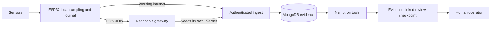

# Safe Home system intelligence

## November 8: Safe Home operator investigation

The device workspace now exposes **Conditions → Nemotron investigation**. Signed-in operators can run real Nemotron on live or registered exercise devices. The exercise-only Simulator is an explicit choice, labeled as not AI. Public `/demo` and browser-generated Simulation Studio frames remain separate: they do not create registered devices for this API.

Results display the actual persisted tool trace, cited sensor values and observation/receipt times, bounded-input coverage, proposed device policies and the 24-hour runtime target. Runtime stays unknown without a supplied energy/draw budget; the optional input form is described below. A fresh run requests a new snapshot; interrupted waits retry the same request ID. Failed runs show their partial trace. Abandoned runs become failed on an authorized status read/retry after three minutes; late completion cannot revive them.

Model requests now use a compact projection with a 16,000-character conversation ceiling and a smaller grounding pack. Latest readings, unresolved incidents, help state, correlation references and deterministic policies remain mandatory; omitted history/context is reported. Mandatory evidence that cannot fit fails explicitly before inference. This is a conservative character bound, not an exact tokenizer guarantee. Citations must refer to records actually supplied to the model. Original stored evidence is unchanged. Failed POST responses include the actor-scoped run ID, trace and sanitized error; completed responses include allowlisted `citedEvidence` metadata.

The NVIDIA adapter uses manual redirect handling and rejects non-success responses. Cloudflare Workers rejects `redirect: "error"`; the assembled app test exposed and fixed this compatibility issue.

Verification: real Nano 9B v2 completed all four tools using synthetic records in disposable MongoDB, both through the CLI and the local Cloudflare app. Browser Stop waiting → Retry recovered the same completed run, and the explicit simulator remained labeled. Battery figures in the CLI example are fictional inputs, not measured endurance. Publication status is recorded in WORKLOG.

## November 8 follow-on: review queue, observation checks and brief

Implemented in the Nemotron follow-on branch as Ayan's integration workstream. Release and production verification belong in WORKLOG; this section alone does not establish that the newest code is deployed.

**Review** is a separate operator sidebar view. Opening it or refreshing observations loads the deterministic queue only. **Run Nemotron review** explicitly sends the bounded, allowlisted group summaries to the configured NVIDIA server. Exercise mode also offers **Simulator**, labeled as scripted and not AI. Public/browser-generated simulations do not populate this queue. Selecting a group opens its primary device's Conditions view; same-home peer records remain inspectable in the saved snapshot.

The queue order is a human-review policy, not an AI risk score: unresolved help/high or critical incidents first; recorded water, alarm-proxy, power and conflicting/unsupported-value concerns next; missing/stale conditions or failed API reachability next; other reporting groups last. No category declares a home safe. A fresh battery or connectivity reading alone does not establish a fresh condition observation. `lastConditionObservedAt` is separate from `lastObservedAt` for any included reading.

The scan examines at most **240 enabled devices**, in registered-device-ID order, then groups by valid home ID (otherwise by device) and returns at most **12 groups** in review order. Coverage reports examined/total devices, examined/returned groups, omissions, limits and separate `scanComplete`/`shortlistComplete` flags. With a partial scan, the queue is not claimed to be the highest-priority homes across the unexamined fleet. One highest-priority unresolved incident per device is expanded; additional incident counts remain visible. Latest-timestamp binary readings preserve positive, negative and unsupported-value representatives, including normalized power aliases. Duplicate/additional values are counted as omitted. Same-time conflicting help/OK reports retain the help request for review; only a strictly newer observed OK can supersede it.

### Fleet API and model workflow

`GET /api/ops/review-queue?mode=exercise` returns `{mode, generatedAt, queue, coverage, policy, nvidia}` without calling a model or saving an investigation. Omit the mode query for live data. Each queue item includes its group ID, device IDs, fixed priority, reasons with source IDs, timestamps, evidence, unknowns and item coverage. IDs are `home:<registered-id>` or `device:<registered-id>`; display labels are generated from IDs, not personal names or addresses.

Start an explicit fleet model review with:

```json
{
  "requestId": "fleet-review-001",
  "engine": "nemotron"
}
```

Send that body to `POST /api/ops/review-queue?mode=exercise`. `engine` is required; only `requestId` and `engine` are accepted. The server loads a new snapshot, rather than accepting client-supplied evidence. `engine: "simulator"` is restricted to exercise mode.

1. `read_fleet_shortlist` reads group summaries, review reasons and exact coverage.
2. `check_review_gaps` inspects missing/stale evidence and snapshot limits.
3. `save_fleet_checkpoint` saves a cited interpretation for human review after both reads complete.

The model cannot reorder the deterministic queue. Fleet citations refer to supplied **queue-group IDs**, whose underlying source records are retained in the snapshot; they are not presented as model citations to individual sensor rows. Compact reason tables and shared uncertainty dictionaries keep the bounded model input within a 16,000-character conversation guard. Oversized input fails explicitly; this is not an exact tokenizer guarantee. The model must name at least one cited group and explain a specific concern or gap. Known unsupported partial-scan/shortlist claims trigger one bounded correction attempt, then a clear failure if unresolved. The separately generated `checkpoint.coverageStatement` remains authoritative. These checks do not validate every sentence of model prose.

POST returns an actor-scoped run with `{id, state, mode, engine, model, simulated, trace, snapshot, checkpoint, error, modelVerified}` plus run timestamps. `GET /api/ops/review-queue?mode=exercise&run_id=<id>` retrieves it. First completion returns 201; identical request-ID recovery returns 200 or 202 while running; changing engine with the same ID returns 409. Failed runs do not silently restart. A three-minute lease expires abandoned running records on an authorized read/retry, and late completion cannot revive them. Fleet and device investigations share the four-runs-per-operator-per-minute limit. Runs expire after 30 days. Four model rounds and a 55-second workflow deadline bound the fleet call; no arbitrary database query, messaging, dispatch or hardware tool is offered.

Both fleet and device endpoints deny anonymous/public-demo access and isolate live/exercise modes and saved runs by actor. `modelVerified: true` means real model inference completed; it is not a claim of factual accuracy. Provider failure never switches silently to the simulator.

### Device checks, supported actions and responder draft

The existing four-tool device investigation now adds `checkpoint.sensorChecks` and `checkpoint.responderBrief`. **Sensor cross-checks** are explicitly labeled deterministic observation-quality checks. They cover latest-time disagreements, flame readings needing corroboration, stale latest records, delayed uploads, absent power/water observations, and Wi-Fi association without verified internet/API delivery. Missing or negative corroboration never rules out fire or clears a critical observation. Findings carry supporting source IDs where evidence exists; missing-data findings do not invent citations. The bounded result reports omitted findings.

`correlate_signals` provides these checks to Nemotron alongside explicit relationships. Source IDs must have been supplied to the model. Water-review and power-review actions are offered only when the input contains supporting observations/events/incidents, and the checkpoint must cite matching support. An unsupported action receives at most one bounded correction request; continued failure saves no completed checkpoint or brief. General internal check-in/device-health/connectivity review actions remain available. Action validation does not certify model prose or authorize an external action.

The **Responder brief · draft** separates recorded facts and observation/receipt timestamps, unknowns, labeled model interpretation, and a proposed follow-up. It is assembled from the validated checkpoint and immutable allowlisted evidence. The brief repeats at most 24 facts and reports omitted records. **Copy brief** and **Download .txt** act locally in the browser; no responder, household or vendor receives a message from these controls. The simulator version remains labeled as not AI.

**Runtime estimate · optional** now accepts a target from 1–168 hours, remaining usable Wh, all three normal/saver/critical draws, and an assumption or operator-supplied bench-measurement basis. Leave energy/draw blank or use **Clear estimate** to retain unknown runtime. The UI reserves 15% of supplied energy. The target and a calculated projection are not measured endurance, and the proposal is not applied to hardware.

### Repeatable verification

`npm run review:demo` creates a disposable local MongoDB fixture with multiple synthetic home scenarios, runs labeled simulator reviews and checks saved results. `npm run review:demo -- --nvidia` uses the configured real model on those synthetic observations. No Atlas households or production telemetry are seeded by this helper. See the script's `--output` option for an artifact and WORKLOG for the latest actual run, failures, fixes and publication evidence.

November 7, 2026. Adyaan's integration workstream, preserving Ayan's command-center/product work and Dhruv's firmware/API work.

## Implemented in this branch

- Evidence joins: home → device → sensor reading/event → unresolved incident. MongoDB stays; these are document relationships, not a SQL migration.
- Source timestamps and receipt timestamps stay separate. An old reading uploaded after reconnection is not presented as a fresh observation. Missing/stale evidence is unknown; last-known critical observations stay visible.
- Deterministic normal/saver/critical policies and explicit battery projections. Policy proposals cannot disable alarms, logging, the help button or peer reception.
- Bounded NVIDIA function-calling workflow and an explicitly labeled simulator. Each run saves a 30-day evidence snapshot, tool-action trace and internal review checkpoint.
- Operator-only API routes, exercise/live separation, request idempotency, validated tools/source IDs, time/call/rate limits, and no model-directed arbitrary queries or hardware commands.

The original November 7 work left the map UI and firmware sketches unchanged; the November 8 UI is described above. Cloud policy fields say `appliedToHardware: false`. Consult current hardware documentation for firmware integration and bench status; a model checkpoint does not prove a physical setting was applied.

## API contract

`GET /api/ops/system?device_id=<id>&mode=exercise` returns the evidence graph, sensor timeline, correlations, policies and NVIDIA configuration state. Omit `mode=exercise` for live records. Scope: target plus up to seven same-home peers. Latest readings per sensor are loaded independently of the bounded history (200 readings, 50 events and 20 active incidents per device); truncation is explicit. Active critical incidents are checked separately so the cap cannot clear them.

`POST /api/ops/agent?mode=exercise` starts an investigation:

```json
{
  "requestId": "demo-investigation-001",
  "deviceId": "REPLACE_WITH_REGISTERED_EXERCISE_DEVICE_ID",
  "engine": "simulator",
  "goalHours": 24,
  "budget": {
    "basis": "assumption",
    "remainingWh": 8,
    "reserveFraction": 0.15,
    "loadsWatts": { "normal": 1, "saver": 0.2, "critical": 0.4 }
  }
}
```

The example energy/draw values are fictional. A budget applies only to the target box, not every peer or the hub. Omit it to show runtime as unknown. `basis: "bench_measurement"` is an operator assertion, not independent certification by the server. `goalHours` defaults to 24 and accepts 1–168.

Use the existing operator session/same-origin flow or server-side admin key. Anonymous callers and public demo accounts cannot use these endpoints. Never put the admin key in browser code. The simulator is allowed only on exercise devices. `engine: "nemotron"` makes actual model calls; missing credentials/upstream errors fail explicitly and never silently switch to simulation.

`GET /api/ops/agent` reports configuration and tool names, not verified connectivity. `GET /api/ops/agent?mode=exercise&run_id=<id>` retrieves the calling operator's run. An identical request ID returns the existing run without repeating inference; changed inputs with the same ID return 409. Failed runs remain failed; submit a new ID deliberately after fixing the cause. A terminated request may leave a running audit record, which expires on an authorized read/retry after three minutes. Background resume and scheduled investigation are not implemented.

## Nemotron beyond a chatbot

1. `read_sensor_timeline` inspects source readings, observation/receipt timestamps and open incidents.
2. `correlate_signals` evaluates explicit relationships, such as water and power loss reported by the same device within two minutes. Co-occurrence does not prove causation.
3. `plan_power_budget` runs deterministic policies and energy calculations.
4. `save_review_checkpoint` saves an evidence-cited interpretation and pending internal follow-up action after the investigation tools complete.

Limits: four model rounds, eight tools, 55-second workflow deadline, 20-second individual request deadline, four investigations per operator per minute. Only allowlisted fields reach the model: no names, addresses, credentials or arbitrary notes. Model prose is marked unverified; cited IDs must exist. Checkpoints do not send messages, contact vendors, dispatch responders, decide claims, clear critical incidents or change hardware settings. This creates a reviewable work product rather than just a conversational answer.

**November 7 update: real Nemotron verified on Brev.** The user authorized a $60 credit budget. `nvidia/NVIDIA-Nemotron-Nano-9B-v2` now runs on a Crusoe L40S; its authenticated HTTPS probe and the complete four-tool workflow passed against fictional observations in disposable local MongoDB. Run `npm run system:demo -- --nvidia` with the ignored local NVIDIA environment to repeat that real inference check. Plain `npm run system:demo` remains the labeled simulator. The shared default remains `nvidia/llama-3.3-nemotron-super-49b-v1.5`; deployment explicitly sets the Nano model ID. See [Brev setup](BREV.md) for cost, shutdown, scope and endpoint limits. A successful exercise is not a comprehensive quality evaluation or hardware validation.

Official references: [NVIDIA function calling](https://docs.nvidia.com/nim/large-language-models/1.15.0/function-calling.html), [hosted model endpoint](https://docs.api.nvidia.com/nim/reference/nvidia-llama-3_3-nemotron-super-49b-v1_5-infer).

## Whole-system responsibilities



The box must sample, log, retain alerts and handle its button without cloud inference. Nemotron is a server-side model, not an LLM running on the ESP32. Cloud investigation follows upload; during disconnection the command center has last-known evidence, not live knowledge.

Wi-Fi RSSI, association, internet reachability and API acknowledgement are separate signals. RSSI is not speed. Prefer bounded authenticated upload probes over battery-draining speed tests. ESP-NOW is a local peer link, not an internet service; a reachable gateway still needs its own uplink. See [Espressif ESP-NOW](https://docs.espressif.com/projects/esp-idf/en/stable/esp32s3/api-reference/network/esp_now.html).

## Power targets

| Mode | Trigger | Sample | Report | Wi-Fi retry | Optional loads |
| --- | --- | --- | --- | --- | --- |
| Normal | Fresh mains present, no critical condition | 2 s | 30 s | 60 s | Camera/display allowed |
| Saver | Power lost or unknown | 2 s | 120 s | 300 s | Camera/display off |
| Critical | Current/last-known critical observation or unresolved critical incident | 2 s | 30 s | 60 s | Camera/display off; essentials retained |

These are proposed timings, not measured guarantees. The existing firmware has blocking network calls; guaranteed two-second sampling during uploads requires a nonblocking network task and bench validation. Do not deep-sleep the gateway without a tested peer wake schedule: ordinary [light/deep sleep powers down wireless peripherals](https://docs.espressif.com/projects/esp-idf/en/stable/esp32s3/api-reference/system/sleep_modes.html).

Runtime = `remaining usable Wh × (1 − reserve fraction) / average measured W`. Reserve defaults to 15%. **24 hours is a design target; 72 hours is a stretch goal. Neither is measured.** A missed goal asks for more usable capacity/less optional load, never disabled critical functions. The existing firmware's box-B voltage-to-percent conversion is an uncalibrated legacy estimate. This new engine never treats voltage or that percentage as usable Wh. Box A currently has no measured battery state of charge.

## Confirmed pickup and physical build

The user's November 7 6:53 PM HARP screenshot says **Picked up**. Visible: USB-C cable ×1; **6×AA holder ×1**; breadboard ×1; jumper kit ×1; diodes ×4; F-F/M-F jumper sets ×1 each; resistors ×10; DS1307 ×2; flame ×1; PIR ×1; power module ×2; tilt ×1; water sensor ×2. The title says “+18 more”; unseen items are not independently confirmed. Existing repo records separately list team-owned ESP32-S3 Sense, ESP32, Uno Q, microSD, button and buzzer.

Use one battery-backed water/power recorder as the primary demo and the other board as a peer. One holder does not establish independent backup for two boxes and the hub. It also does not establish installed cells, chemistry, capacity or working switchover. No cellular/LoRa radio or air-quality sensor is visible in the screenshot.

Water ADC counts are not flood depth without calibration. PIR cannot prove a home empty. Flame/sound modules are proxies, not certified fire/smoke detectors.

Before powering the boards, identify the exact power-module model, regulator type, output rails and peak-current rating. No raw AA pack voltage goes to GPIO, the 3.3 V rail or lithium battery pads. Sense the isolated low-voltage wall supply upstream of backup, never household AC. Check divider output over the fresh-pack voltage range and verify USB/backfeed protection. Follow [Seeed's board power documentation](https://wiki.seeedstudio.com/xiao_esp32s3_getting_started/).

The [DS1307 datasheet](https://www.analog.com/media/en/technical-documentation/data-sheets/DS1307.pdf) specifies 5 V operation and battery-backed timekeeping. Inspect module I2C pull-up voltage and any coin-cell charging circuit before connecting to the ESP32 bus. Clock battery backup does not power the box. A proper UPS/power-path controller or level shifter is not confirmed by the screenshot.

## Bench acceptance and remaining firmware work

| Test | Evidence needed | Current status |
| --- | --- | --- |
| Water event | Calibrated wet/dry threshold, original timestamp and stable event ID | Physical test pending |
| Pull wall supply | No reboot; loss event while recording continues | Power-path test pending |
| Remove internet | Continued SD samples, stale cloud state | Physical test pending |
| Reconnect | Original timestamps replay, duplicate handling, unresolved critical retained | Backend tested; physical replay pending |
| Shed optional loads | Measured current reduction with alarms/logging/relay intact | Reference policy only |
| Endurance | Continuous unplugged run plus measured energy/draw | 24 h target only |

Before relying on firmware replay, reconcile its classification of every HTTP 409 as permanent: beacon ingest also uses a transient 409 for processing receipts. Test SD-full behavior, interruption during queue-offset writes, and ACK durability. These are recorded integration gaps, not claimed fixes in this branch.

## Run and present

`npm ci` then `npm run system:demo` starts disposable local MongoDB, creates synthetic water/power/Wi-Fi observations, runs the explicit simulator, persists and retrieves the checkpoint, then shuts down. It never accesses Atlas or production homes. Add `-- --output /tmp/homebeacon-system-demo.json` for a synthetic artifact.

For four speakers in three minutes: problem/year-round leak prevention (0:00–0:35); verified water/unplug demo or explicitly labeled simulation (0:35–1:20); four tool actions and checkpoint (1:20–2:20); insurer follow-up value, evidence limits and next measurements (2:20–3:00). Two minutes remain for Q&A. Do not claim NVIDIA integration while demonstrating the simulator.

Suggested work split: firmware/power bench; ingest/evidence; Nemotron/workflow; map/demo/story. Proposed targets are State Farm, NVIDIA, Hardware and MongoDB Atlas, subject to event entry limits and demonstrated integrations.
