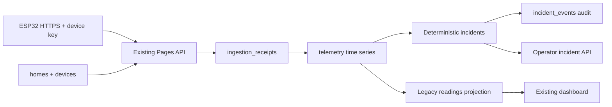

# HomeBeacon MongoDB architecture

HomeBeacon extends the existing JavaScript Cloudflare Pages API; no Python backend is required. Atlas is the deployed database. Local MongoDB is for development and isolated tests. Existing `/api/ingest`, rules, alerts, sessions, and dashboard contracts remain available. HomeBeacon endpoints use `/api/beacon` and the same registered device ObjectId and hashed per-device key as the existing API. The existing `/api/devices/:id` returns the home association and latest observation.



## Collections and indexes

All times are BSON UTC dates; public IDs use ObjectId strings except the stable receipt ID `deviceId:eventId`. Homes reference devices through `devices.homeId`; unbounded telemetry and audit history are separate collections. Sensor snapshots and threshold evidence are small bounded embedded objects. JavaScript models are documented with JSDoc in `src/beacon.js`; runtime request validation rejects invalid types and ranges.

| Collection | Fields and indexes |
| --- | --- |
| `homes` | `_id`, `label`, GeoJSON `location`, `createdAt`, `updatedAt`; `location: 2dsphere` |
| `devices` | Existing key hash, name, type, meta, disabled fields; `homeId`, `lastSeen`, `lastObservedAt`, `lastSequence`, `latestTelemetry`; existing unique `keyHash` plus `homeId` lookup. `_id` is the unique device identity. |
| `telemetry` | `observedAt` time field, `meta` containing stable deviceId/homeId references, seconds granularity; `receivedAt`, `eventId`, optional sequence and five sensors, clockSource. Index `meta.deviceId, observedAt DESC`. Retention 30 days, deleted asynchronously by MongoDB TTL. |
| `ingestion_receipts` | Unique `deviceId,eventId` and primary key `deviceId:eventId`; fingerprint, canonical telemetry, processing state, completion time and incident IDs. No TTL: retained to prevent old IDs being reused after telemetry expires. Capacity planning/archival is a follow-up. |
| `incidents` | Home/device references, type/severity/status, trigger evidence, detectedAt/lastObservedAt, creation/update/resolution dates, sourceReceipt, simulated marker. Sparse unique activeKey enforces one active incident per device/type. Home/date, status/severity/date, device/status indexes. |
| `incident_events` | Append-only logical creation, observation and operator action records; stable IDs make creation/observation insert-if-absent safe on retry. Incident/time index. Operator requests and outcomes are separate records; a pending request without an outcome signals interrupted processing. |
| `readings` | Existing ordinary collection; each HomeBeacon sensor is projected with a stable `_id`, preserving existing dashboard sensor names and avoiding duplicate projection on retries. |

A `beacon_schema` readiness marker prevents ingest from accidentally creating an ordinary telemetry collection before setup. The controlled setup command checks MongoDB version (6.3+) and existing time-series options before creating indexes; it never drops or converts collections. A mismatched existing telemetry collection blocks setup for manual migration. Validate against the actual Atlas cluster before deployment. MongoDB time-series collections [do not support unique indexes or transactional writes](https://www.mongodb.com/docs/manual/core/timeseries/timeseries-limitations/). No unique index or upsert is used on telemetry.

## Ingestion and failure semantics

1. Validate the body, authenticate `X-Device-Key`, require a real home assignment, and verify payload identity against the key. Unknown fields are discarded. Values are limited to temperature -80..150 C, humidity/battery 0..100 and booleans for water/power.
2. Reserve the event in the ordinary receipt collection. Identical completed retries return the stored acknowledgement; changed payloads with the same event ID return 409. Sequence is an optional diagnostic high-water mark, not the deduplication key (firmware must generate an event ID unique across reboots).
3. Insert telemetry, mark the receipt persisted, evaluate deterministic hazards, project sensor readings and update the device, then complete the receipt. Partial post-insert work can be resumed by replaying the same event.
4. Concurrent wet readings upsert against the sparse unique active incident key. Water=true opens a critical flood incident, external power=false a medium outage, and temperature >=55 C a high-temperature incident. These are prototype thresholds, not validated emergency detection. Incidents latch until an operator resolves them; dry/cool readings do not auto-resolve or flap incident state. A new hazardous event after resolution may create a new incident.
5. The receipt and time-series writes cannot be atomic. An interrupted reservation/insert/mark operation stays `reserved` and returns 409 on retry rather than risking a second insert. Pause all ingestion, allow in-flight requests to end, then use the reconciliation command below. This is an MVP availability tradeoff, not an exactly-once transaction guarantee. A process failure immediately after reservation but before insert needs operator inspection; no automated repair guesses whether a delayed insert may still complete.

```sh
# Only after ingestion is paused and there are no in-flight requests:
BEACON_INGESTION_PAUSED=true npm run db:reconcile -- '<deviceId>:<eventId>'
# Exactly one matching measurement must exist. Then resend the original payload.
```

If no measurement exists, an operator must confirm no write can still arrive, then explicitly repair the reservation using the canonical payload retained in the receipt. Multiple measurements require manual review. Reconciliation does not delete data. Post-insert retries can execute concurrently; unique active keys and deterministic projection/audit IDs make ordinary retry side effects idempotent. There is no cross-collection transaction: simultaneous operator resolution and ingestion can still race and must be reconciled from the audit log. No promise of crash-atomic incident transitions is made.

Missing observation times use the first receipt's server timestamp, marked `server_fallback`. Supplied timestamps need a timezone; more than five minutes ahead or older than retention are rejected. Replayed observations retain their original time and do not overwrite newer `latestTelemetry`. Receipt time updates lastSeen; it does not prove a device is currently online. Existing dashboard freshness marks data older than five minutes stale. Late hazardous readings are retained as historical evidence and may open a stale incident for review.

## API and authorization

Reads reuse the existing admin key/session policy; writes require the admin key (or the established operator session middleware). ESP32 ingress uses only its device key. Public exercise accounts remain blocked from live API routes. Do not enable `API_PUBLIC_READ` for private homeowner data. All insurer response, claims, dispatch and notification flows are simulated; these endpoints perform no external actions.

| Method and path | Purpose |
| --- | --- |
| `POST /api/setup` | Explicit idempotent bootstrap of legacy and HomeBeacon indexes |
| `POST /api/beacon/homes` | Create a home with label and GeoJSON Point |
| `POST /api/devices` | Existing registration; returns device.id and one-time deviceKey |
| `PATCH /api/beacon/devices/:id/home` | Assign a home once; changing a bound home needs explicit migration |
| `POST /api/beacon/ingest` | Validated sensor event; 202 acknowledgement with accepted/duplicate/incident_ids |
| `GET /api/devices/:id` | Existing device status, latestTelemetry and homeId; no key hash |
| `GET /api/beacon/devices/:id/telemetry?from=...&to=...&limit=100` | Descending history, default last 24 hours; max 30-day range and 1000 results |
| `GET /api/beacon/incidents?status=open&severity=critical` | Operator queue, capped at 500 results |
| `GET /api/beacon/homes/:id/incidents` | Home incident history |
| `PATCH /api/beacon/incidents/:id` | status=acknowledged or resolved; operator audit |
| `GET /api/beacon/homes/nearby?lat=32.98&lon=-96.75&radius_m=5000` | Geospatial home query, max 50 km and 100 homes |
| `GET /api/ready` | Existing DB ping diagnostic; 503 if unavailable; no credentials exposed |

History is limit-bounded; cursor pagination, WebSocket delivery, automatic stale-device jobs, calibrated hysteresis and an incident management UI are future work. Projection feeds the existing live dashboard; the new incident queue currently uses the API. Seed devices are exercise-only and intentionally excluded from that dashboard.

## Atlas setup and verification

Use the team's existing Atlas cluster and `MONGODB_DB=utd_hackathon_26`. Prior logs report successful checks from another checkout; this checkout has no credentials, and those reports are not proof this change has run on Atlas.

1. An Atlas project owner must supply a database user scoped to read/write on this database, its SRV connection string, and a network access rule for the execution environment. Use Atlas Connect to obtain the driver URI. Keep TLS verification enabled and percent-encode credential characters. Do not use management API keys as database credentials.
2. Copy `.env.example` to ignored `.env`, put the `mongodb+srv://...` URI in `MONGODB_URI`, the database in `MONGODB_DB`, and set a random `API_ADMIN_KEY`. Set the same runtime values as encrypted Cloudflare settings; local Wrangler reads `.dev.vars`, not `.env`. Never put database/admin secrets in ESP32 or browser code.
3. Prefer local development IP `/32` allowlists. Cloudflare outbound addresses can change; use a supported private/static-egress approach for a restricted deployment. Existing project notes record a previously authorized broad access rule; that is a historical configuration, not a recommended permanent network policy. Do not alter rules or create a second project without the owner's involvement.
4. With Node 22+ run `npm ci`, `npm run db:setup`, then set a local random `BEACON_DEMO_DEVICE_KEY` and run `npm run db:seed`. Reruns preserve seeded documents and completed receipts. Seed contains three fictional homes, a disconnected ESP32 placeholder and two simulated incidents. It creates no real homeowner PII.
5. Run `npm run dev` (with `.dev.vars` configured). Use the curl sequence in `clients/esp32/HOMEBEACON.md` to create a separate test home/device, ingest one wet event twice, inspect one telemetry document and one flood incident, query history and nearby homes, and check `/api/ready`. Use Atlas Data Explorer to confirm `telemetry` contains BSON dates and the expected event ID. Seeding alone is not live hardware verification.
6. Run `npm test` for isolated local MongoDB validation and `npm run build` for Cloudflare compilation. Tests do not use deployed Atlas. Cloud environment connectivity, indexes, seed, ingest, retry, history and geography checks remain required before claiming deployed completion.

## AI integration boundary

The existing NVIDIA adapter is retained. Nemotron can later wrap device status, recent telemetry, incident queue and nearby-home queries as read-only tools. A recommendation persistence/review API is not implemented by this database slice. Any future AI recommendation must store model provenance, evidence references and review state, label text AI-assisted, and require human approval for consequential operations. No automatic emergency dispatch, claims submission, notifications or model-only priority updates are added.
